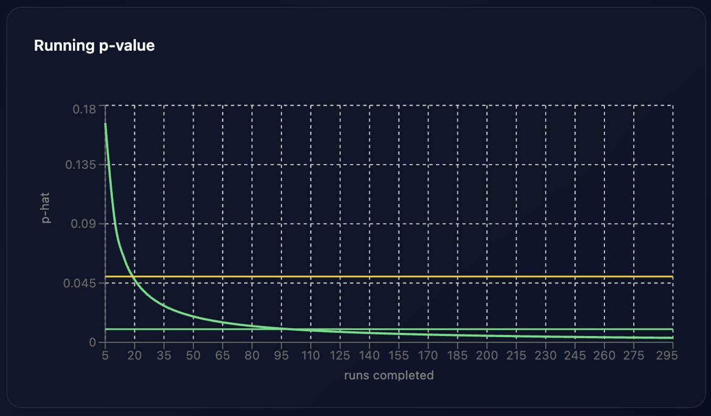

# Interactive Exp-Min LLM Watermarking

An interactive Exp-Min watermarking demo I built for my practical work in AI at Johannes Kepler University Linz. It uses a local language model to generate watermarked text, detect the watermark, and explore what happens when the text is edited.

The app has a Python/FastAPI backend and a React/TypeScript frontend. Model inference runs through `llama-cpp-python`.

[Read the report](Report.pdf)



## About the project

The implementation adapts the algorithm and code from [Robust Distortion-free Watermarks for Language Models](https://arxiv.org/abs/2307.15593) by Kuditipudi et al. ([original repository](https://github.com/jthickstun/watermark)). My focus was on turning it into a working application with streaming generation, statistical detection, text editing and live visualization.

You can generate text with a watermark key, check it with the detector, then edit or corrupt the text and run detection again. The detector estimates a p-value using Monte Carlo trials. It checks for a specific keyed watermark; it cannot detect arbitrary AI-generated text.

This is a demonstration of the method, with some implementation changes described in the report. It is not an exact reproduction of the paper or a comprehensive benchmark.

## Run with Docker

You need Git, Docker and Docker Compose.

```bash
git clone https://github.com/TimToller/practical-work-lm-watermarking.git
cd practical-work-lm-watermarking
```

Download the model into `backend/models/`:

```bash
mkdir -p backend/models
curl -L --fail \
  -o backend/models/llama-3.2-3b-instruct-q4_k_m.gguf \
  'https://huggingface.co/hugging-quants/Llama-3.2-3B-Instruct-Q4_K_M-GGUF/resolve/main/llama-3.2-3b-instruct-q4_k_m.gguf?download=true'
```

Then start the app:

```bash
docker compose up --build
```

Open **http://localhost:8080**. The backend runs on port `8000`, with API documentation at http://localhost:8000/docs.

The first build and model load may take a while. To stop the app:

```bash
docker compose down
```

If you use a different model filename, update `MODEL_PATH` in `docker-compose.yml`. The container expects models under `/app/models/`. Model weights are separate from this repository; see the [model page](https://huggingface.co/hugging-quants/Llama-3.2-3B-Instruct-Q4_K_M-GGUF) for its license.

## Local development

You need Python 3.12+, `uv`, Node.js 22.12+ and `pnpm`. Download the model as above. Installing `llama-cpp-python` may also require CMake and a C++ compiler.

From the repository root, start the backend:

```bash
cd backend
uv sync --frozen
cd ..

MODEL_PATH="$PWD/backend/models/llama-3.2-3b-instruct-q4_k_m.gguf" \
  uv run --project backend uvicorn backend.app.main:app \
  --reload --host 127.0.0.1 --port 8000
```

In another terminal, start the frontend from the repository root:

```bash
cd frontend
pnpm install --frozen-lockfile
pnpm dev
```

Open the address printed by Vite, normally http://localhost:5173. API requests are proxied to the backend on port `8000`.

These commands use bash/zsh syntax. On Windows, set `MODEL_PATH` using your shell's environment-variable syntax.

## Notes

- Generation speed depends on your hardware and model. GPU support depends on how `llama-cpp-python` was built.
- Detection results depend on the text, key and settings. A p-value is not the probability that the text was written by AI.
- The corruption tool makes character-level edits. It does not simulate all types of rewriting or paraphrasing.
- The report covers the implementation, observations and limitations in more detail. Its LaTeX source is in `documentation/`.
